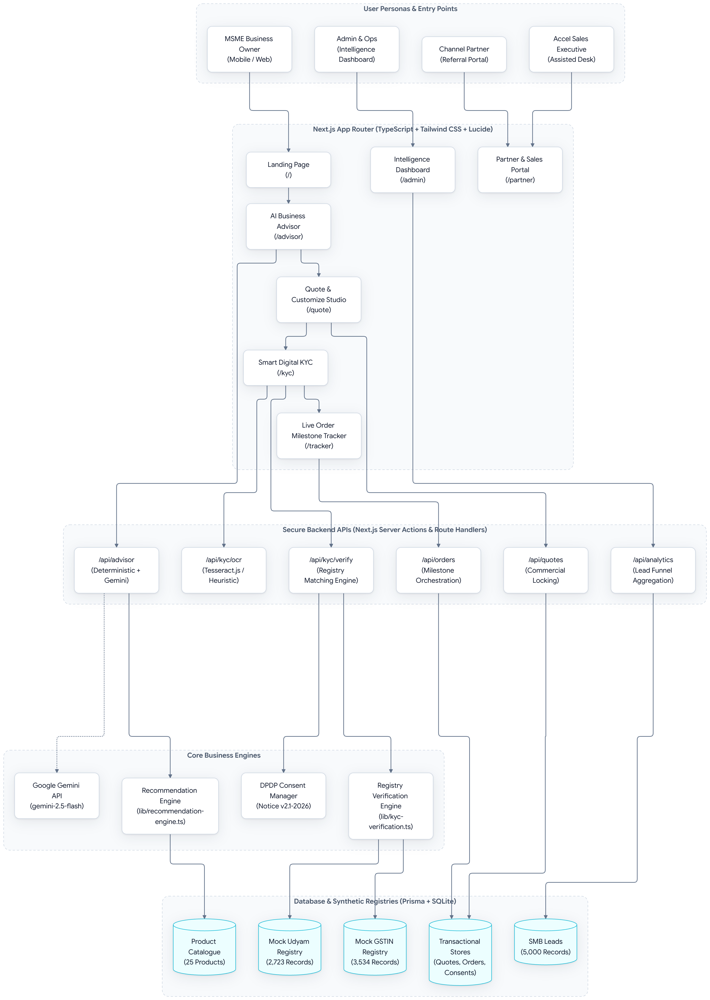
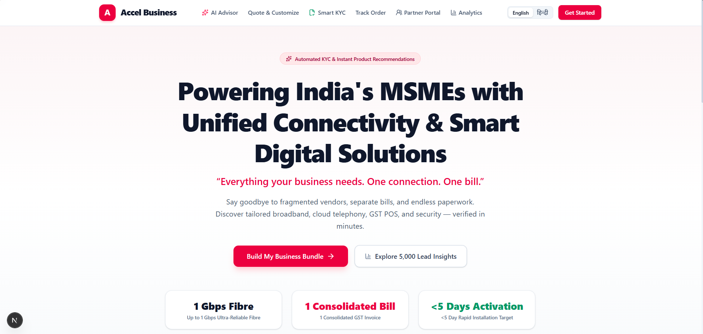

<div align="center">

# Accel Business — Udyam Digital

**India's first end-to-end digital acquisition platform for MSME telecom bundles.**

A full-stack Next.js application that takes an SMB owner from *"I need internet"* all the way to *"Service is live"* — entirely online, in minutes, with zero paperwork.

[](https://nextjs.org)
[](https://www.typescriptlang.org)
[](https://www.prisma.io)
[](https://tailwindcss.com)
[](#)

</div>

---

## 🏗️ System Architecture & Workflow Diagram


> **Core Architecture Flowchart:** Complete end-to-end component flow from multi-persona ingestion to the deterministic recommendation engine, LLM augmentation layer, Smart KYC cross-registry verification, and field force dispatch.

<div align="center">

### 📌 System Architecture Flowchart


*Figure 1: Full System Architecture & Data Flow — User Personas, Presentation Tier, Secure Next.js Route Handlers, Deterministic Engine, SQLite/Prisma Persistence, and Mock Government Registries.*

</div>

---

## 🌐 Landing Page (Bilingual: English & Hindi)

The storefront presents the product proposition clearly to an MSME owner who lands from a campaign link or QR code. Features tailored MSME categories, instant CTA, live value counters, and dual-language localization.

| English Landing Page | Hindi Landing Page (पूर्ण हिन्दी अनुवाद) |
| :---: | :---: |
|  |  |
| *Hero, Value Props & Sector Portfolios* | *संपूर्ण हिन्दी अनुवाद एवं व्यापारिक श्रेणियां* |

<div align="center">

  
*Figure 2: Sector Bundles Showcase & Comparison of Traditional 17.6-Day Process vs. Accel Digital Model*

</div>

---

## 💡 The Problem It Solves

India has **63 million MSMEs**. Real analysis of our dataset containing **5,000 MSME leads** revealed significant operational friction:

- **17.6-day activation cycle:** Customers wait over two weeks and make **3+ follow-up chase calls** due to opaque progress tracking.
- **Fragmented vendors:** Businesses manage separate bills and customer care numbers for broadband, CCTV, POS, and mobile SIMs.
- **Paperwork fatigue:** **273 leads dropped** at the quote stage because of lengthy manual paperwork and confusing fee structures.
- **High blended CAC:** Customer acquisition costs average **₹15,000 per activated customer** under field-heavy visits.

**Accel Business Udyam Digital** collapses that entire journey — advisory, quotation, KYC verification, ordering, and installation tracking — into a single, bilingual, mobile-first web application, reducing activation time from **17.6 days to under 5 days** and targeting **≥30% conversion**.

---

## 🗺️ Full User Journey

```
Landing Page (/)
    │
    ▼
AI Advisor (/advisor)         ← [6-Step Discovery / Presets / Zero-Hallucination Engine]
    │   Step 1: Business type (Retail, Clinic, Restaurant, Factory, Office…)
    │   Step 2: Employee headcount & operational sites
    │   Step 3: Location city & market tier (Tier-1 Metro / Tier-2 Emerging)
    │   Step 4: Connectivity bandwidth & SLA requirement
    │   Step 5: Essential digital tools (POS, CCTV, Wi-Fi, Cloud Backup, Security)
    │   Step 6: Communication channels (Postpaid SIMs, SIP IVR, WhatsApp API, SMS)
    │   [Optional Gemini AI natural language explanation]
    │
    ▼
Quote Studio (/quote)
    │   Bundle pre-loaded from advisor via localStorage
    │   Customer adjusts quantities & add-ons (mandatory core items locked)
    │   Contract commitment selector (10% discount for 12 mo / 15% for 24 mo)
    │   Live GST-aware arithmetic (18% input credit eligible)
    │   Saves quote to database (SavedQuote model)
    │
    ▼
Smart KYC (/kyc)
    │   DOT-compliant privacy & affirmative consent notice (Notice v2.1-2026)
    │   12-specimen dossier explorer (K01–K12) or file upload
    │   Local OCR extraction (Tesseract.js) with client-side field review
    │   Tri-registry validation (Mock GSTIN + Mock Udyam + 90-day address proof)
    │   Automated exception triaging: Verified / Manual Review / Rejected
    │
    ▼
Order Tracker (/tracker)
    │   Persistent Order ID (ORD-YYYYMM-XXXX)
    │   7-stage real-time progress pipeline
    │   Assigned field engineer dispatch & feasibility clearance
    │   Interactive demo simulator button to advance lifecycle live
    │
    ▼
    🎉 Service Activated (<5 Days SLA)
```

---

## 📸 Product Walkthrough & Interface Gallery

Screenshots of the complete digital journey captured directly from the live application:

### 1. 🤖 AI Business Advisor — `/advisor`

A guided 6-step questionnaire that matches exact catalogue items using our deterministic engine with optional Gemini AI explanation.

| Step 1: Business Profile Selection | Step 2: Scale & Employee Count |
| :---: | :---: |
|  |  |
| *Adaptive Question 1: Industry Category* | *Adaptive Question 2: Employee Count & Operational Sites* |

| Step 3: Location & City Tier | Step 4: Bandwidth & Uptime Need |
| :---: | :---: |
|  |  |
| *City Location, Market Tier & Tax Registrations* | *Connectivity Speed, Leased Line SLA & 5G AirFiber* |

| Step 5: Essential Digital Tools | Step 6: Customer Communication |
| :---: | :---: |
|  |  |
| *Cloud POS, CCTV, Managed Wi-Fi & Backup* | *Postpaid CUG, Cloud Telephony IVR & WhatsApp API* |

<div align="center">

#### 🎯 Generated Bundle Recommendation Screen
  
*Figure 3: Deterministic Product Recommendation with Zero-Hallucination Pricing, Add-ons & Sector Rationale*

</div>

---

### 2. 📋 Quote Studio & Commercial Checkout — `/quote`

Live interactive commercial configuration with line-item management, add-on toggles, and live price recalculation.

<div align="center">

  
*Figure 4: Commercial Summary, Add-on Toggles, Line-item Breakdown & GST Input Credit*

</div>

**Key capabilities:**
- **Auto-loads** the bundle from the Advisor via `localStorage`.
- **Customer & service location fields** — Business name, contact, mobile, city, state, PIN code.
- **Dependency protection** — Mandatory core products cannot be removed while retaining dependent services.
- **Real-time totals** — Subtotal, commitment discount, 18% GST, one-time setup, and net monthly bill.

---

### 3. 🛡️ Smart Digital KYC & Registry Verification — `/kyc`

Paperless 4-step verification engine with unbundled affirmative consent, OCR review, and synthetic registry validation.

<div align="center">

  
*Figure 5: KYC Verification Outcome — Registry Cross-Matching, Status Validation & Exception Handling*

</div>

**Validation checks:**
- **GST Portal Match** (`GstinRecord` table, 3,534 records) — Validates 15-char format, Active status, and trade name.
- **Udyam MSME Match** (`UdyamRecord` table, 2,723 records) — Validates enterprise type and NIC activity.
- **Address Proof Recency** — Rejects utility bills older than 90 days from July 15, 2026.
- **Exception Scenarios** — Automatically detects expired bills (K08), signatory mismatches (K10), and suspended GSTINs (K11).

---

### 4. 📦 Live Order Milestone Tracker — `/tracker`

Real-time visibility from order submission to optical fiber termination and service activation.

<div align="center">

  
*Figure 6: Real-time 7-Stage Milestone Progression, Dispatch Details & Audit Trail*

</div>

**7-Stage Pipeline:**
1. Application Received → 2. KYC Processing → 3. KYC Verified → 4. Order Confirmed → 5. Installation Scheduled → 6. Installation in Progress → 7. **Activated** ✅

---

### 5. 📊 MSME Intelligence Dashboard & Partner Portal (`/admin` & `/partner`)

Macro analytics over 5,000 SMB leads and distributor referral management.

| Admin Funnel & Drop-off Intelligence | Channel Efficiency Analytics |
| :---: | :---: |
|  |  |
| *Funnel Progression, 6-Month Churn & Drop Bottlenecks* | *Referral, Inbound, Field & Partner Acquisition Cost / Conversion* |

<div align="center">

#### 🤝 Channel Partner & Field Force Portal
  
*Figure 7: Partner Referral Submission, Assisted Onboarding Queue & Commission Payouts*

</div>

---

## 🛠️ Tech Stack

| Layer | Technology | Purpose |
|:---|:---|:---|
| **Framework** | Next.js 16.4.5 (App Router, Turbopack) | Modern full-stack React framework with SSR and server routes |
| **Language** | TypeScript 5 | Strict end-to-end type safety |
| **Styling** | Tailwind CSS 4 | Utility-first responsive design in enterprise telecom theme |
| **Database & ORM** | Prisma 5.22 + SQLite | Local transactional database with full schema typing |
| **Icons** | Lucide React | High-clarity SVG icon library |
| **Charts** | Recharts | Dynamic funnel charts, bar graphs, and segment metrics |
| **OCR Engine** | Tesseract.js | Client & server optical character recognition without external APIs |
| **Conversational AI** | Google Gemini 2.5 Flash via `@google/genai` | Natural language business rationales (with offline fallback) |
| **Testing** | Custom assertion test suite via `tsx` | 12 automated unit tests across recommendations, KYC & formats |

---

## 📁 Project Structure

```
udyam-digital/
├── assets/                    # System architecture flowchart + UI screenshots
│   ├── flowchart.png          # System Architecture & Flowchart diagram
│   └── image *.png            # Captured application UI walkthrough images
├── prisma/
│   ├── schema.prisma          # Database models (Products, Leads, Registries, Orders, Quotes)
│   ├── seed.ts                # Database seed script for 5,000 leads, 25 products & registries
│   └── dev.db                 # Local SQLite database
├── src/
│   ├── app/
│   │   ├── page.tsx           # Digital landing page (Bilingual EN/HI)
│   │   ├── advisor/           # AI Business Advisor wizard
│   │   ├── quote/             # Quote Studio & commercial checkout
│   │   ├── kyc/               # Smart Digital KYC verification
│   │   ├── tracker/           # Live Order Milestone Tracker
│   │   ├── partner/           # Channel Partner & Sales Portal
│   │   ├── admin/             # MSME Intelligence Dashboard
│   │   └── api/
│   │       ├── advisor/       # POST: Deterministic recommendation engine + optional AI
│   │       ├── quotes/        # GET/POST: Quote persistence
│   │       ├── orders/        # GET/POST/PATCH: Order lifecycle management
│   │       ├── kyc/
│   │       │   ├── ocr/       # POST: Document OCR extraction
│   │       │   └── verify/    # POST: Cross-registry KYC verification
│   │       └── analytics/     # GET: Aggregated 5,000 lead funnel insights
│   └── lib/
│       ├── recommendation-engine.ts  # Deterministic bundle algorithm
│       ├── kyc-verification.ts       # GSTIN / Udyam / address proof validation rules
│       ├── kyc-specimens.ts          # K01–K12 test dossier records
│       ├── translations.ts           # Complete EN / HI translation string table
│       └── prisma.ts                 # Prisma client singleton
├── tests/
│   └── unit-test.ts           # 12 automated assertions
├── .env                       # Environment variables (gitignored)
└── .vscode/
    └── settings.json          # Workspace configuration
```

---

## 🚀 Getting Started

### Prerequisites

- Node.js 20+
- npm

### Setup

```bash
# 1. Install dependencies
npm install

# 2. Push database schema & seed from synthetic CSVs
npx prisma generate
npx prisma db push
npx tsx prisma/seed.ts

# 3. Configure environment (optional — app runs 100% offline without key)
# Add your Gemini API key from https://aistudio.google.com/ to .env
GEMINI_API_KEY=AIzaSy...

# 4. Start the development server
npm run dev
```

Open [http://localhost:3000](http://localhost:3000) in your browser.

### Run Automated Tests

```bash
npm test
# 🎉 Test Results: 12/12 assertions passed!
```

---

## 🔑 Environment Variables

A single `.env` file at the project root:

```env
DATABASE_URL="file:./prisma/dev.db"

# Optional — enables Gemini AI explanation enhancements
# App operates with complete deterministic fallback when empty
GEMINI_API_KEY=
```

---

## 🌐 Complete Bilingual Support

Every page supports full **English / हिन्दी** localization via the header toggle. All UI text, error banners, button labels, stage descriptions, and product rationale strings are translated.

---

## 📋 KYC Compliance & Regulatory Notes

The KYC flow is engineered to align with Indian telecom regulatory expectations:
- **DOT CAF (Customer Acquisition Form)** attributes captured: Legal Name, GSTIN, Udyam Number, Signatory Details, Address Proof.
- **Granular Consent Architecture:** Purpose-specific, un-preselected affirmative consent for identity verification, document OCR, and telecom fulfillment.
- **Address Proof Validity:** Automatic age calculation rejecting bills older than 90 days from the baseline date (July 15, 2026).
- **Automated Exception Handling:** Mismatched names, unverified numbers, and suspended tax registrations are automatically quarantined for manual review.

---

<div align="center">

Built for the **Accel YTL Hackathon (Track A: Project Udyam Digital)**

*Connecting 63 million Indian MSMEs to enterprise-grade digital infrastructure — one bundle at a time.*

</div>
